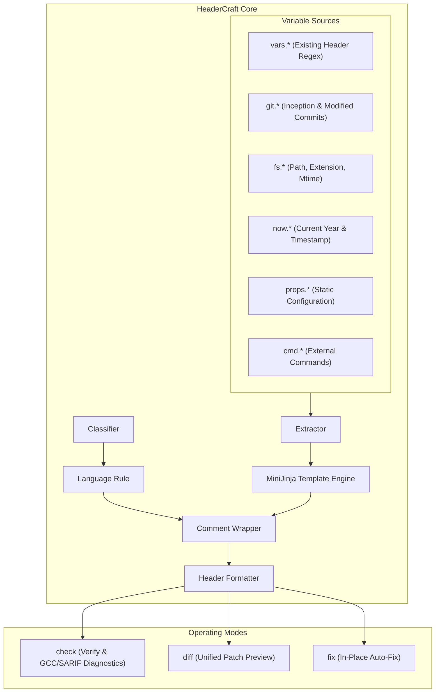
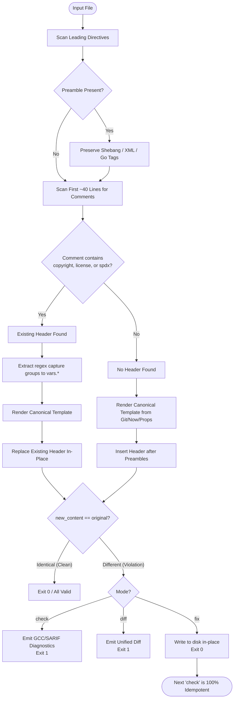
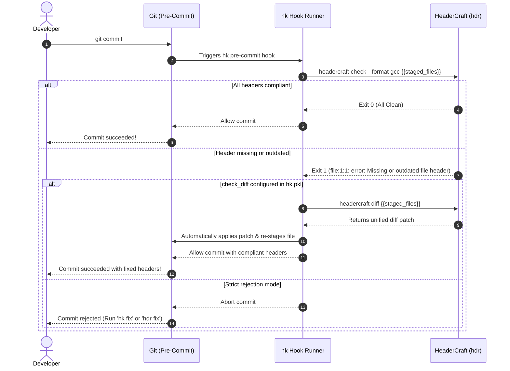

# HeaderCraft (`hdr`)

A high-performance, pluggable file header scanner, validator, and formatter written in **Rust**, designed for sub-5ms pre-commit execution and native integration with [`hk`](https://github.com/jdx/hk) and [`mise`](https://mise.jdx.dev).

---

## Features

- ⚡ **Sub-5ms Execution:** Compiles to a single zero-overhead native static binary.
- 🔍 **Regex Capture Extraction:** Extracts metadata (inception year, author, owner) from existing file headers and reuses them when updating headers.
- 📅 **Automatic Year Range Updating:** Inception year is preserved or resolved from Git history, while the ending year dynamically updates to the current year (e.g. `2018-2026`).
- 🧩 **Multi-Source Template Context:** MiniJinja template engine with access to:
  - `vars.*`: Variables captured from the file's existing header via named regex groups.
  - `git.*`: First commit year (`git.created_year`), last commit year (`git.modified_year`), author (`git.author`), and dirty state (`git.is_dirty`).
  - `fs.*`: Filesystem attributes (`filename`, `stem`, `extension`, `dir`, `mtime_year`).
  - `now.*`: Current year (`now.year`), date (`now.date`), and ISO timestamp.
  - `props.*`: Static properties defined in `headercraft.toml`.
  - `cmd.*`: Dynamic outputs from external shell commands defined in `[commands]`.
- 🛡️ **Intelligent Placement:**
  - Preserves shebangs (`#!/usr/bin/env python3`) on Line 1.
  - Preserves XML prologs (`<?xml version="1.0" ...?>`) on Line 1.
  - Preserves Python encoding comments (`# -*- coding: utf-8 -*-`).
  - Preserves Go build constraints (`//go:build` and legacy `// +build`).
  - Protects internal non-header comments (e.g. comments inside methods or after imports).
  - Preserves native CRLF (`\r\n`) line endings on Windows.
- 🔌 **Native `hk` Integration:** First-class support for `hk` pre-commit hooks via standard GCC diagnostic output (`--format gcc`), unified patch diffs (`headercraft diff`), and automatic fixes (`headercraft fix`).

---

## How It Works

HeaderCraft operates as a deterministic pipeline combining multi-source metadata extraction, preamble preservation, and comment formatting.

### 1. Architectural Overview



### 2. Header Detection & Lifecycle Flowchart



### 3. Variable Inception Precedence

When updating copyright year ranges, HeaderCraft follows a strict 3-tier precedence hierarchy:

```text
1. Existing Header (vars.start_year)
   └─► If the file already has 'Copyright 2012 Acme', 2012 is preserved.
       (Protects original authorship even if git history was rewritten or truncated)

2. Git Commit History (git.created_year)
   └─► If no header exists, HeaderCraft queries the initial commit timestamp via:
       git log --diff-filter=A --format=%ad --date=format:%Y -1 -- <file>

3. Current Year (now.year)
   └─► If the file is untracked or Git is disabled, falls back to wall-clock year.
```

Template example:
```jinja

Copyright (c) {{ start }}-{{ now.year }} {{ props.owner }}.
```

---

## Operating Modes

HeaderCraft provides three complementary commands:

| Command | Purpose | Output | Exit Code |
|---|---|---|---|
| `headercraft check` | Linting & CI verification | GCC diagnostic lines (`--format gcc`), SARIF (`--format sarif`), or human summary | `0` = all valid, `1` = violations found |
| `headercraft diff` | Patch generation & code review | Standard unified diff (`--- a/` `+++ b/`) | `0` = no diff, `1` = diff exists |
| `headercraft fix` | Automated formatting | In-place file modification | `0` = success |

### Native Pre-Commit Hook Sequencing with `hk`



---

## Startup & Language Benchmarks

Pre-commit hooks require near-instantaneous feedback. Here is how HeaderCraft compares across runtime environments:

| Implementation | Runtime / Binary | Cold Startup | Warm / Hook Run | Dependencies |
|---|---|---|---|---|
| **HeaderCraft (Rust)** | Native Binary | **~2–4 ms** | **~2–4 ms** | **Zero runtime dependencies** |
| Go Alternative | Native Binary | ~3–5 ms | ~3–5 ms | Zero runtime dependencies |
| Python (`python3`) | CPython 3.12 | ~18–25 ms | ~15–20 ms | Requires Python runtime |
| Python (`uvx`) | uv cache runner | ~120 ms (cold) | ~40 ms (cached) | Requires `uv` toolchain |
| Java (Standard HotSpot) | OpenJDK 25 | ~380 ms | ~380 ms | Requires JRE |
| Java (Leyden AOT Cache) | OpenJDK 25 AOT | ~35 ms | ~35 ms | Requires JDK 25 Leyden cache |

---

## Installation

### Via `mise`
Add HeaderCraft to your `mise.toml`:
```toml
[tools]
"cargo:headercraft" = "latest"
# Or from GitHub release once published:
# "github:your-org/headercraft" = "latest"
```

### From Source
```bash
cargo install --path .
```

---

## Quick Start

Initialize a default `headercraft.toml` configuration:
```bash
headercraft init
```

Check files for header compliance:
```bash
# Human readable output
headercraft check

# GCC format for hk / linters
headercraft check --format gcc

# SARIF output for GitHub Code Scanning
headercraft check --format sarif
```

Preview changes as a unified diff:
```bash
headercraft diff
```

Apply headers in place:
```bash
headercraft fix
```

---

## Configuration (`headercraft.toml`)

```toml
[header]
# Global MiniJinja template for canonical headers
template = """

Copyright (c) {{ start_year }}-{{ now.year }} {{ vars.owner | default(props.owner) | default('Acme Corp') }}. All rights reserved.
"""

# Named regex capture groups extract existing metadata to reuse in template
extract_regex = '(?i)copyright\s+(?:\(c\)\s+)?(?P<start_year>\d{4})(?:-(?P<end_year>\d{4}))?\s+(?P<owner>[^\n\.\,]+)'

# Header detection keywords (matches any comment containing these words)
keywords = ["copyright", "license", "spdx"]

[props]
owner = "Acme Corp"
license = "Apache-2.0"

# Dynamic external commands: results become available as {{ cmd.<name> }}
[commands]
git_branch = "git branch --show-current"
user = "whoami"

[git]
enabled = true

[files]
includes = ["**/*"]
excludes = ["target/**", "build/**", ".cache/**", ".git/**", "node_modules/**"]

# Retain built-in rules for standard languages (C, Java, Python, Shell, XML, etc.)
inherit_default_rules = true

# Pluggable Language Rules (custom languages or overrides)
[[rules]]
name = "elixir"
extensions = ["ex", "exs"]
style = "line"            # "line" or "block"
comment_prefix = "# "

[[rules]]
name = "custom_sql"
extensions = ["sql"]
style = "line"
comment_prefix = "-- "
# Optional per-rule template override (overrides [header].template for this rule)
template = "-- PROPRIETARY DATABASE SCHEMA -- DO NOT REPLICATE"
```

### Supporting Unknown File Formats

HeaderCraft can support **any** unknown file format purely through configuration without recompiling:

```toml
[[rules]]
name = "protocol_buffers"
extensions = ["proto"]
style = "line"
comment_prefix = "// "

[[rules]]
name = "ninja_build"
filenames = ["build.ninja"]
style = "line"
comment_prefix = "# "

[[rules]]
name = "custom_scripts"
content_patterns = ["^# syntax=myscript.*"]
style = "line"
comment_prefix = "# "
```

---

## Integration with `hk`

Configure `hk.pkl` to run HeaderCraft natively in your git hooks:

```pkl
amends "package://github.com/jdx/hk/releases/download/v2.11.0/hk@2.11.0#/Config.pkl"

steps {
  ["headers"] = new Step {
    glob = "**/*.{rs,py,java,c,cpp,xml,sh,toml}"
    exclude = List("Cargo.lock", "target/**")
    check = "headercraft check --format gcc {{files}}"
    check_diff = "headercraft diff {{files}}"
    fix = "headercraft fix {{files}}"
    diagnostic_format = "gcc"
    diagnostic_tool = "headercraft"
  }
}
```

When violations occur, `hk` reports clean diagnostics:
```text
❯ headers
  headers – Test.java:1:1: error: Missing or outdated file header [headercraft]
hk ERROR To fix, run: headercraft fix Test.java
```

---

## Running with `mise`

Add tasks to your `mise.toml`:

```toml
[tools]
rust = "stable"
hk = "2.11.0"

[tasks.build]
description = "Build headercraft in release mode"
run = "cargo build --release"

[tasks.test]
description = "Run test suite"
run = "cargo test"

[tasks.check]
description = "Run formatting, linter, and tests"
run = "cargo fmt -- --check && cargo clippy --all-targets -- -D warnings && cargo test"

[tasks.pre-commit]
description = "Run pre-commit hook via hk"
run = "hk run pre-commit"
```

---

## License

Licensed under the [Apache License, Version 2.0](LICENSE).
