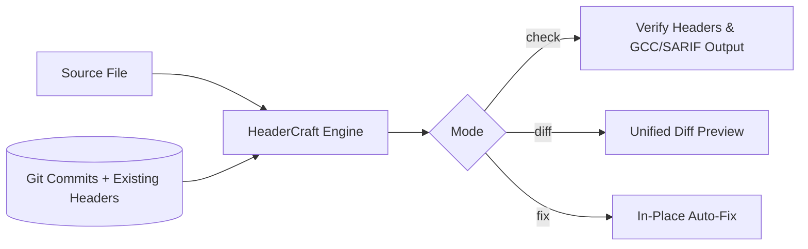

# HeaderCraft (`hdr`)

[](https://github.com/macintorsten/headercraft/actions/workflows/ci.yml)
[](LICENSE)
[](https://www.rust-lang.org)
[](https://github.com/jdx/hk)

**HeaderCraft** is a blazing-fast (<5ms), pluggable license and copyright header manager written in Rust.

It checks, formats, and enforces top-of-file headers in Git repositories and pre-commit hooks. It resolves original inception years from Git history or existing headers, updates current year ranges dynamically, and protects language preambles (shebangs `#!`, XML prologs, and Go build tags).

```go
// Before:
package main

// After:
// Copyright (c) 2014-2026 Acme Corp.
// SPDX-License-Identifier: MIT

package main
```

---

## How It Works at a Glance



### 3-Tier Date Resolution
When generating year ranges (e.g. `2018-2026`), HeaderCraft avoids manual date maintenance:
1. **Existing Header** (`vars.start_year`): Preserves original author year from current file comments.
2. **Git History** (`git.created_year`): Looks up initial commit year if no header exists.
3. **Current Year** (`now.year`): Uses wall-clock year if untracked.

---

## Quick Start

```bash
# 1. Initialize starter configuration
hdr init

# 2. Check files (exits 0 if valid, 1 if missing/outdated)
hdr check

# 3. Preview changes as unified diff
hdr diff

# 4. Fix headers in-place
hdr fix
```

---

## Integration with `hk` Pre-Commit Hook

HeaderCraft is designed for seamless, sub-second execution with [`hk`](https://github.com/jdx/hk):

```pkl
amends "package://github.com/jdx/hk/releases/download/v2.11.0/hk@2.11.0#/Config.pkl"

steps {
  ["headers"] = new Step {
    glob = "**/*.{rs,go,py,java,ts,c,xml,sh}"
    exclude = List("target/**", "vendor/**")
    check = "headercraft check --format gcc {{files}}"
    fix = "headercraft fix {{files}}"
    check_diff = "headercraft diff {{files}}"
    diagnostic_format = "gcc"
    diagnostic_tool = "headercraft"
  }
}
```

In pre-commit, `hk` checks staged files in ~2ms. If headers are missing or outdated, it can either reject the commit with clean diagnostics or auto-fix them on the fly.

---

## Configuration (`headercraft.toml`)

```toml
[header]
# MiniJinja template: inception year is preserved, end year updates to current year
template = """

Copyright (c) {{ start }}-{{ now.year }} {{ props.owner }}.
SPDX-License-Identifier: {{ props.license }}
"""

# Extract existing year & author from files to avoid overwriting original dates
extract_regex = '(?i)copyright\s+(?:\(c\)\s+)?(?P<start_year>\d{4})(?:-(?P<end_year>\d{4}))?\s+(?P<owner>[^\n\.\,]+)'

[props]
owner = "Acme Corp"
license = "Apache-2.0"

[git]
enabled = true

[files]
includes = ["**/*"]
excludes = ["target/**", "node_modules/**"]

# Retain built-in rules for C, Java, Python, Shell, XML, SQL, etc.
inherit_default_rules = true

# Pluggable custom rules (add unknown formats easily)
[[rules]]
name = "custom_lang"
extensions = ["xyz"]
style = "line"          # "line" or "block"
comment_prefix = "// "
```

---

## Template Variables Reference

| Namespace | Variable | Type | Description |
|---|---|---|---|
| **`vars.*`** | `vars.<name>` | `string` | Captured from existing header via `extract_regex` (e.g. `vars.start_year`, `vars.owner`). |
| **`git.*`** | `git.created_year` | `integer` | First commit year where file was added. |
| | `git.modified_year` | `integer` | Last commit year for the file. |
| | `git.author` | `string` | Initial commit author name. |
| | `git.is_dirty` | `boolean` | `true` if file has uncommitted changes in git. |
| **`fs.*`** | `fs.filename` | `string` | Full filename (e.g. `main.go`). |
| | `fs.extension` | `string` | File extension without dot (e.g. `go`). |
| **`now.*`** | `now.year` | `integer` | Current wall-clock year (`2026`). |
| | `now.date` | `string` | Current date (`YYYY-MM-DD`). |
| **`props.*`** | `props.<key>` | `any` | Static values configured under `[props]`. |
| **`cmd.*`** | `cmd.<name>` | `string` | Output from external commands in `[commands]`. |

---

## Interactive Examples

Run and test real scenarios in the [`examples/`](examples/) directory:

- [**01-spdx-migration**](examples/01-spdx-migration/): Migrating legacy verbose boilerplate to compact SPDX tags.
- [**02-corporate-confidential**](examples/02-corporate-confidential/): Proprietary security classification banners with XML prolog handling.
- [**03-generated-code**](examples/03-generated-code/): Deterministic `@generated - DO NOT EDIT` provenance notices.
- [**04-dual-licensing**](examples/04-dual-licensing/): Dual Apache-2.0 / MIT licensing notices.
- [**05-git-pre-commit-hook**](examples/05-git-pre-commit-hook/): Live clone of `fatih/color` with full `hk` pre-commit hook walkthrough.

---

## Installation

### Via `mise`
```toml
[tools]
"cargo:headercraft" = "latest"
```

### From Binary Releases
Pre-compiled static binaries for Linux (x86_64, aarch64), macOS (Intel, Apple Silicon), and Windows are available on GitHub Releases.

### From Source
```bash
cargo install --path .
```

---

## License

Licensed under the [Apache License, Version 2.0](LICENSE).
